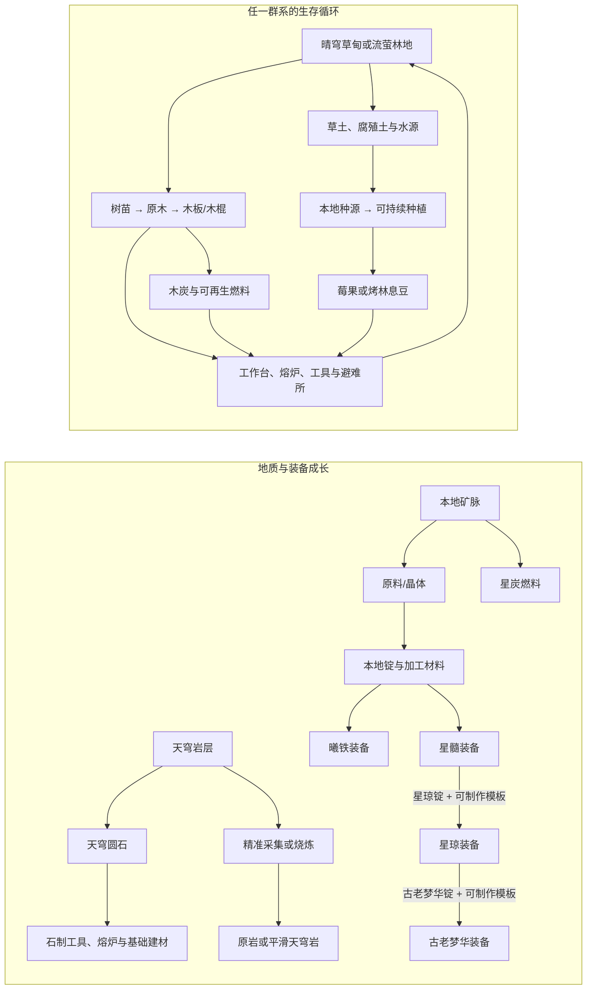

# 1.18.0 版本计划：命途遗境生态与生存循环

日期：2026-10-18；最终状态更新：2026-10-19。当前状态：**阶段 0 至阶段 6 的本版规划工作均已完成；阶段 1–5 的内容与阶段 6 的指南、定位器、票券和单机完整生存循环均已验收。曦铁配方复核中发现的问题已修正，并包含在用户确认通过的正式版中。多人同步未测试（目前无多人测试条件），作为已知覆盖限制记录，不是本版单机验收或正式发布的阻塞项。1.18.0 已发布至 GitHub。**

## 一、版本目标

命途遗境的最终目标，是成为像主世界一样可以长期生存、探索、建设和成长的完整维度：玩家能在其中获得持续发展的资源，发现不同群系的生态与地点，并有理由长期停留，而不是只为一次性挑战或少数专属材料来访。矿物只是这套维度体验的一部分。

1.18.0 将从头重做命途遗境的自然环境框架：重新设计两个自然生态区域、地貌、方块、矿物与资源生成，并补齐植被、群系特有食物和可持续生存条件。后续版本仍可继续扩展生物、群系、探索地点和生态内容，本版不宣称一次做完整个维度。遗迹蓝图与遗器决斗场的结构修改、材质替换不纳入 1.18.0，留待后续规划。

本版按可验收的玩家循环推进：**落脚与返程有保障 → 采集本地基础资源 → 制作工具、工作台和避难所 → 获得可持续食物、燃料与水 → 开采并加工维度材料 → 探索区域并应对战斗 → 能安全返程或继续定居。**玩家进入维度前仍须完成主世界群系探索，因此不要求把 The Path 变成复制主世界全部科技树的独立开局地图；但玩家不应为了温饱、照明或基本建造而被迫反复回主世界。

主成长线是提升命途阶位；行迹、光锥、遗器和遗迹挑战仍是角色成长的重要组成。新增生态资源用于支撑探索与建造，不另设一套强制升级系统，也不把新材料变成晋阶门槛。

### 整体主题方向：以自然世界为主体，星空元素为点缀

命途遗境应像主世界一样，是由自然生态构成、可以长期生存和探索的新维度。平原、森林、山地、水系、沙地、洞穴和地下矿层承担主体；星空只融入少量天空景象、植物细节、特殊矿物和局部地貌，不把整个维度做成外太空、星际荒原或废弃车站主题。

- 地表采用玩家熟悉的自然生态逻辑：连续的草地与泥土、河流和湖泊、沙岸、砾石坡、森林与山地，形成可理解的地形过渡。昼夜与天气使用原版式自然循环；按群系气候设置温度和降水，让雨水、湿润土壤与植被形成合理联系。天空亮度和远景可读性以主世界体验为参照。
- 星空特色控制在点缀层：晴朗时可见不同于主世界的星空或微弱天象；少量花草、晶体和矿物带有星点纹理或夜间微光。普通土壤、草木、水体和石层仍以自然色彩为主，不大面积染成蓝紫色。
- 两个群系通过自然生态类型区分，例如开阔草甸与林地湖泊；危险来自洞穴、地形、敌对遭遇和探索路线，不靠持续阴暗或工业废墟营造。
- 贴图保留各自材质特色，并在大面积生成时维持柔和的明暗层次；不把所有方块统一漂白，也不把星空元素铺满每个方块。

## 二、1.17.0 基线与当前缺口

- **已做到：**接入命途遗境维度与两个生物群系；实现维度入口、返回信标和行旅档案；接入普通遗迹、命途遗迹及遗器决斗场；实现过一批维度方块、矿物和对应的基础加工内容。
- **未做到：**没有形成完整的自然地表、土壤与地下岩层；没有覆盖维度各群系的常用矿物资源体系；缺少本地树木、植被、可持续食物、燃料、水源和农耕循环；群系生态、环境差异和长期生存流程尚未完善；尚无星琼、古老梦华及其工具、武器和盔甲成长线。
- 本节只记录 1.17.0 的完成情况与缺口。它是历史基线，不是 1.18.0 的资产清单或设计模板。1.18.0 对维度地貌、群系生态、方块、材料、矿物、贴图、生成规则和结构融入方式重新规划；不要求沿用既有方块、矿物、材质、注册 ID、旧蓝图或主题。

## 三、两个区域的定位

以下生态和资源名称是设计工作名，贴图、掉落、配方和正式命名应在实现前统一定稿。

| 区域 | 主要气质 | 本地生存资源 | 探索压力 |
| --- | --- | --- | --- |
| 晴穹草甸（显示名候选） | 明亮开阔的草甸、缓坡与河谷；草地、花丛、稀疏树群和远处山地形成自然层次，少量星点花与晶簇作为点缀 | 新规划的草土、沙砾与常见岩层自然过渡；草甸树群、可再生果丛、野生种子和浅水溪流 | 视野开阔、路线易读；河谷、山坡、洞穴和较远的补给点提供探索变化，原版敌对生物维持基础战斗风险 |
| 流萤林地（显示名候选） | 有河流、湖泊和林间空地的明亮森林；树冠有疏密变化，阳光能照进林下，不做成阴暗密林或人造遗址区 | 新规划的林地土壤、草木、砂岸、砾石和地下岩层；可再生树木、林下食物植物、蕨类与少量带星点微光的苔花 | 林间视线和水岸路线比草甸曲折；林地洞穴、坡地和湖岸提供探索差异，白昼仍保持清晰可见 |

两个区域都属于自然世界，但不能只是同一批矿石和植物换色。草甸侧重开阔地貌、草本植物和溪流；林地侧重树木、林下生态、湖泊与林间空地。两区各自都要能启动基础建造、补充食物和取水；种源与可再生材料必须在本区稳定获得，不能只依赖罕见宝箱或跨区单向软锁。

**共享资源原则：**命途遗境的常用矿物和装备成长矿物应作为维度级资源，能在当前及未来加入的各个命途遗境群系生成，允许不同群系调整矿脉密度和露头表现，但不把基础进阶材料锁在单一群系。群系差异主要由表层地貌、植被、食物、水源、局部建材和探索环境体现。

| 生存内容 | 晴穹草甸候选方向 | 流萤林地候选方向 | 共同要求 |
| --- | --- | --- | --- |
| 可再生建材 | 零散树群和小型林带，能获取原木、树苗与枝材 | 连片但有林间空地的常见树木群落，可稳定获取原木、树苗与枝材 | 每个群系都能独立凑齐工作台、箱子、基础工具和照明所需的制作链 |
| 特有食物 | “晨露莓”类草甸果丛，野外自然结实，可采种扩繁 | 林下浆果、可食菌类或另一种林地作物，可留种并循环种植 | 两者外形、采集反馈和用途不同；各自可循环种植，不靠另一个群系或宝箱启动 |
| 地表植物 | 高草、野花、低矮果丛与少量树群，形成开阔远近层次 | 林冠、灌木、蕨类、苔藓、林下食物植物和林间空地 | 植物簇与水源、地形和资源点相互关联，不按固定间距铺设；微光只作为少量星空点缀 |
| 水与耕作 | 溪流、浅河、池塘和河岸湿润土壤 | 森林溪流、湖泊、泉眼和湖岸湿地 | 继续使用原版水桶、耕地与作物规则；不加饮水条或特殊液体门槛 |
| 地下探索 | 丘陵洞穴、河谷切面和晶脉露头 | 林地下方的洞穴、湖岸石灰岩式地形与晶脉露头 | 同一共享矿物成长线都能挖到；地形与洞穴表现区分区域气质 |

“晴穹草甸”“流萤林地”以及“晨露莓”等均为讨论用的显示名和内容暂名；正式名称、植物与地形设计应在阶段 0 一起定稿。群系独有内容可以奖励探索和往返，但不能成为食物、工具或返程的硬性门槛。

## 四、地表、地层与矿物体系

### 地表与地下的基本层次

- 两区都采用清晰的自然地表分层：草地和腐殖土连接普通泥土，河岸、湖岸和局部干燥地带出现沙土，坡面与河谷边缘分布碎石和砂岩，下面过渡到连续地下岩层。草甸与林地各有覆盖比例和植物层次，避免整片表面只由一种方块铺平。
- 从草方块、土壤、沙土、碎石、砂岩、浅层岩石到深层岩石，重新设计完整的自然地质方块组；名称、造型、色板和获取方式均在本版确定，并服务于新群系地貌与生存用途。
- 地下主岩层需要有完整的挖掘与加工闭环：普通镐挖掘得到可用于熔炉、石制工具等原版配方的圆石等价物；精准采集保留原石，烧炼可还原为平滑石材。工具等级、掉落、标签与配方按新材料重新配置。
- 洞穴应能暴露不同深度的岩层和矿脉；表土、砂层、砂岩、主石层和深层矿物的比例与高度在世界生成采样后确定，避免人工硬切层或矿石浮在表面。

### 方块主题与材质设计

本版方块从自然生态与地质用途出发重新设计。先确定地表、洞穴、岩层、矿脉和建造用途，再为每种材料设定独立但协调的色板；不同材料不能只靠换色区分，整体表现应服务于明亮的自然群系主题。

| 方块组 | 本版设计要求 |
| --- | --- |
| 草地与土层 | 新设计草方块、普通泥土、腐殖土/粗土；顶面使用自然绿，侧面清楚显示土层。两区共享基础地质逻辑，再按湿度和植被调整局部覆盖 |
| 常见石层 | 新设计浅层与地下主岩石，普通镐挖掘后得到圆石等价物，精准采集保留原石，烧炼可获得平滑石材；加工石材不作为大面积天然表面 |
| 沙土与碎石 | 新设计河沙、砂岩、砾石和可能需要的沉积土，用于河湖岸、干燥坡地与沉积区域，保持沙米色、土褐色和自然灰色层次 |
| 局部特殊岩石 | 只在与新地貌相符的少数位置出现，保留克制的星空来源细节，不替代常见地表和主岩层 |
| 地下晶体 | 为本版矿物体系设计矿石、晶簇和加工建材；发光只用于少量确有设定依据的晶体，不铺满地表 |
| 加工建材 | 根据本版主岩石、砂岩及特色矿物设计可制作的砖、台阶、楼梯和墙体系列；检查同类墙体之间能正确连接 |

必须补齐的基础方块是草方块、土壤层、河岸沉积材料和可用作圆石的地下主岩层。黏土等普通建材可以评估使用原版资源；若新维度需要专属材料，则按实际生态用途独立设计，不为追求方块数量堆叠重复材料。

贴图遵循[方块贴图风格规范](../方块贴图风格规范.md)：16×16 像素网格直接组织细节，不经 8×8 中间稿；草、土、石、沙按主世界自然色彩区分，星点和冷色微光只放在少量特殊材料。要看单块辨识度，也要看 4×4 连续铺放效果，避免高对比碎纹、大面积荧光或每块重复的显眼图案。

### 首版新增方块与物品清单（工作名）

下表是供阶段 0 定稿的新增内容清单，中文名和英文资源键均为候选。每个新方块都必须对应地形、采集、建造或生存用途；同一材料的楼梯、台阶、墙、门等派生形态按标准配方生成，不额外创设只换名字的近似材料。

| 类别 | 工作名与资源键候选 | 自然出现与获取 | 用途与加工 |
| --- | --- | --- | --- |
| 地表 | 晴穹草方块 `path_grass_block` | 草甸与林地表层；精准采集获得草方块，普通采集获得泥土 | 两区共享草地方块和生长规则，草色按群系环境调色 |
| 地表 | 晴穹泥土 `path_dirt` | 两区草层下；用锹采集 | 草方块下的基础土层；可长草、可锄耕，支持本地作物 |
| 地表 | 林息腐殖土 `path_forest_humus` | 林地树下、湿润低地和林缘 | 林地特色土层；锹可采集、可堆肥，允许树苗和林下植物生长 |
| 地表 | 坡地粗土 `path_coarse_soil` | 草甸山坡、林地坡脚及稀疏植被地带 | 锹可采集；锄耕后转为普通泥土，避免表面形成大块单一草皮 |
| 沉积层 | 澄溪砂 `path_river_sand` | 河岸、湖岸及局部干燥沉积地；受重力下落 | 可烧炼成原版玻璃；可合成砂岩，不新增专用玻璃以免重复原版功能 |
| 沉积层 | 澄溪砂岩 `path_river_sandstone` | 砂层下方和干燥河谷 | 提供完整砂岩砖、切制砂岩、楼梯、台阶和墙体建材系列 |
| 沉积层 | 河床砾 `path_river_gravel` | 河床、河岸转折和山坡冲积带；锹可采集 | 作为自然地表与洞口装饰；小概率掉落燧石，为打火石提供本地来源 |
| 岩层 | 天穹岩 `path_stone` | 两区地下浅至中层；木镐及以上可采，普通采集掉落天穹圆石，精准采集保留原岩 | 天穹圆石可制作石制工具、熔炉及基础石材配方；烧炼原岩得到平滑天穹岩 |
| 岩层 | 深层天穹岩 `path_deep_stone` | 两区更深地下，作为高阶矿物的主要宿主；石镐及以上可采 | 普通采集掉落深层圆石，精准采集保留原岩；烧炼得到平滑深层天穹岩，开采速度略慢于浅层岩 |
| 建材 | 天穹石砖系列 `path_stone_bricks` | 由天穹岩加工获得 | 天穹岩、圆石、平滑岩与石砖各自提供必要的楼梯、台阶、墙；石砖另有裂纹、浮雕两种外观变体，供普通遗迹和命途遗迹使用 |
| 建材 | 深层天穹石砖系列 `path_deep_stone_bricks` | 由深层天穹岩加工获得 | 深色但不近黑的地下建材，提供楼梯、台阶、墙及裂纹款；用于洞穴节点和决斗场基座，保持和新生态相协调 |
| 树木 | 晴穗树木材组 `sunmeadow_*` | 晴穹草甸稀疏树群；树叶自然衰败有概率掉树苗 | 树形矮而树冠舒展，叶色为明亮草绿；包含原木、木头、去皮原木、去皮木头、树叶、树苗、木板及完整标准木板建材组 |
| 树木 | 流萤树木材组 `glimmerwood_*` | 流萤林地常见树群；树叶自然衰败有概率掉树苗 | 树干较高、树冠分层留出林下光隙，叶色偏青绿；包含与晴穗树相同的完整木材建材组，叶片仅有少量浅色斑点、不发强光 |
| 草甸植物 | 晨露莓丛 `morning_berry_bush`、晨露莓 `morning_berry` | 草甸自然成簇生成；成熟采摘得莓果 | 低矮果丛，成熟果实用温和的珊瑚红点缀；莓果可直接食用，也可种在草土/腐殖土上培育新果丛；成熟后可重复收获，骨粉可促进生长，饱食效果不高于原版常见浆果 |
| 草甸植物 | 晴穗花 `sunmeadow_bloom` | 草甸花丛自然生成；骨粉可在草地扩繁 | 米金色小花，适合作为草地色彩点缀；可堆肥并提供原版黄色染料，不作为唯一食物或关键配方门槛 |
| 林地植物 | 林息豆野株 `forestbean_wild`、林息豆作物 `forestbean_crop`、林息豆种 `forestbean_seeds`、林息豆荚 `forestbean_pod`、烤林息豆 `roasted_forestbean` | 林息豆野株在林地腐殖土上自然成簇生成，采收获得种子和豆荚；种子种在耕地后长成作物 | 直立植株带浅青绿豆荚；豆荚可生食，熔炉/烟熏炉加工成烤林息豆作为稳定主食；作物按原版生长与骨粉规则循环收获，营养值不超过常见熟食 |
| 林地植物 | 流萤苔 `glimmer_moss` | 林地潮湿石面、溪边树根和洞口少量生成；骨粉可扩散，剪刀或精准采集可收获 | 装饰和堆肥材料；贴图有低对比星点，但不发光，不增加永久光源负担 |

**原版内容直接复用：**水、耕地、熔炉、工作台、火把、黏土、普通高草和蕨类采用原版方块/规则；本地河砂可以烧制原版玻璃。首版不增加重复的专用工作台、特殊液体或玻璃方块。若后续确需自定义玻璃，必须采用可无缝连接的贴图并单独验收 4×4 连铺效果。

**结构用材：**普通遗迹、命途遗迹与遗器决斗场使用本版天穹石、石砖、砂岩及两套本地木材系列组合出不同布局；结构专属方块只有在这些基础材料无法表达必要用途时才新增，并须先进入本清单审定。

**色彩与连续铺放：**草顶使用接近主世界但略带青金色倾向的自然绿；泥土和腐殖土用两档低饱和暖褐色区分，河砂偏浅米色、砾石偏中性灰，天穹岩为清晰的中浅灰，深层天穹岩只压低明度、不做成近黑。两种树叶分别用暖绿与青绿拉开区别，星点只在流萤树叶、莓果和流萤苔少量出现。矿物在石材上的占比保持克制；每张方块图按 16×16 网格绘制并检查 4×4 连铺，禁止用均匀高对比碎点或强亮边制造识别度。

### 命途遗境的替代矿物与本地燃料

- 不把主世界铜、铁、金、红石、青金石、钻石等原矿原样搬来作为主体；为其常见用途设计命途遗境自己的矿物、原料和锭/晶体，贴合 The Path 的视觉与设定。下表名称均为工作名，正式命名在阶段 0 统一确定。
- 煤炭位置由一类本地燃料矿补足，工作名为“星炭矿”，掉落“星炭”。星炭可直接作为炉燃料，单个燃烧时长按煤炭平衡；可评估加入压缩燃料块，保证储存/燃烧效率符合原版习惯。木炭仍由本地木质资源烧炼获得，作为另一条可再生燃料途径。

| 矿石方块与加工品（工作名） | 采集与生成 | 用途、存储块和加工规则 |
| --- | --- | --- |
| 星炭矿 `path_starcoal_ore` → 星炭 `path_starcoal` | 两区浅至中层 `path_stone` 少量生成；石镐可采 | 直接掉落星炭；单个燃烧 `1600` 游戏刻。9 星炭合成星炭块，可燃烧 `16000` 游戏刻并拆回 9 个星炭 |
| 霞铜矿 `path_dawncopper_ore` → 粗霞铜 `path_raw_dawncopper` → 霞铜锭 `path_dawncopper_ingot` | 两区浅层 `path_stone` 常见；石镐可采，普通采集掉粗霞铜，精准采集保留矿石 | 熔炉/高炉烧炼成锭；锭可合成霞铜块并拆回。供导体、装饰和设备配方使用，不设专属装备阶位 |
| 曦铁矿 `path_suniron_ore` → 粗曦铁 `path_raw_suniron` → 曦铁锭 `path_suniron_ingot` | 两区浅至中层 `path_stone` 常见；石镐可采，掉落与精准采集规则同上 | 烧炼成锭；锭可合成曦铁块并拆回，也可拆为曦铁粒 `path_suniron_nugget`（1 锭→9 粒，9 粒→1 锭）。制作本地铁档工具、武器、盔甲、桶、剪刀和常用配方 |
| 曜金矿 `path_dawn_gold_ore` → 粗曜金 `path_raw_dawn_gold` → 曜金锭 `path_dawn_gold_ingot` | 两区中层至深层 `path_deep_stone`；曦铁镐可采 | 烧炼成锭；锭可合成曜金块并拆回，也可拆为曜金粒 `path_dawn_gold_nugget`（1 锭→9 粒，9 粒→1 锭）。供金类配方、装饰和设备使用，不作为装备成长主干 |
| 谐振晶矿 `path_resonance_ore` → 谐振晶 `path_resonance_crystal` | 两区深层 `path_deep_stone`；曦铁镐可采 | 直接掉落 4–5 枚晶体，时运影响数量；用于信号、自动化和红石等价配方，9 枚可压缩为谐振晶块 |
| 记忆晶矿 `path_memory_ore` → 记忆晶 `path_memory_crystal` | 两区中深层 `path_stone` 或层间过渡带；石镐可采 | 按青金石逻辑直接掉落并提供附魔材料；可压缩为记忆晶块，接入附魔和必要配方 |
| 星髓矿 `path_starmarrow_ore` → 星髓 `path_starmarrow` | 两区深层 `path_deep_stone` 稀有；曦铁镐可采 | 直接掉落星髓晶体，可压缩为星髓块；用于钻石档工具、武器、盔甲，并提供开采星琼矿所需等级 |
| 星琼矿 `path_stellarjade_ore` → 星琼原料 `path_raw_stellarjade` → 星琼锭 `path_stellarjade_ingot` | 两区中深层 `path_deep_stone`；星髓/钻石档镐可采 | 普通采集掉星琼原料，烧炼成星琼锭；9 锭合成星琼块并可拆回，用于下界合金档装备升级 |
| 古老梦华矿 `path_ancientdream_ore` → 古老梦华原料 `path_raw_ancientdream` → 古老梦华锭 `path_ancientdream_ingot` | 两区最深层 `path_deep_stone` 稀有生成；星琼镐可采 | 原料烧炼成锭；9 锭合成古老梦华块并可拆回，用于高于下界合金档的装备升级 |

**矿物方块形态统一规则：**九种矿石方块都采用本版主岩层纹理作底，矿点清楚但不高频闪烁；普通采集产出上表指定材料，精准采集保留矿石方块。霞铜、曦铁、曜金、星炭、谐振晶、记忆晶、星髓、星琼和古老梦华均有对应的储存块，资源键候选依次为 `path_dawncopper_block`、`path_suniron_block`、`path_dawn_gold_block`、`path_starcoal_block`、`path_resonance_block`、`path_memory_block`、`path_starmarrow_block`、`path_stellarjade_block`、`path_ancientdream_block`。金属及高阶锭块由 9 锭合成，晶体块由 9 个完整晶体合成，配方可逆；星炭块由 9 个星炭合成。原料不另做原料块，避免重复方块形态。星琼和古老梦华的物品图以用户提供的锭形态素材为准；储存块需另外绘制立方体贴图，不能把锭图直接拉伸成方块。

矿石贴图共享本版新设计的自然石层底色，矿物部分用少量、清晰的色块区分：燃料矿偏深灰并带克制的暖色矿点；霞铜使用土红/浅绿矿物色；曦铁使用低饱和灰褐色；曜金用有限的暖金色；谐振晶、记忆晶、星髓、星琼和古老梦华再逐级提高稀有感与色彩辨识度。少数特殊晶体可以发光；普通矿石不做霓虹描边或满屏闪点。最终纹理仍按 16×16 网格绘制，并在连续矿脉和洞壁环境里检查观感。

霞铜、曦铁等材料要有清晰的矿石 → 原料 → 加工品路径，并实际支撑命途遗境内的配方与工具进阶；可在安全且符合平衡的情况下接入原版/Forge 材料标签，让其他配方识别，但不要仅靠改贴图或改名就把原版矿石当成新资源。替代关系指玩家能在维度内完成关键生存和成长用途，不默认所有第三方配方都会自动接受新材料；对附魔等使用原版界面、而非普通配方的关键机制，阶段 0 要先确定低风险的本地使用方式。本版新增的特色晶体及用途也需独立设计、独立命名和配置获取链。

**常用配方落地：**曦铁需能制作铁档工具、盔甲、桶、剪刀和打火石等基础物件；曜金提供金锭/粒级的装饰与配方材料；霞铜提供铜制建材与对应功能物品的本地配方；谐振晶用于必要的红石元件配方，记忆晶接入附魔台材料位。对原版配方使用固定物品而不读取标签的情况，提供明确的替代配方；不承诺自动兼容所有第三方配方。

矿脉分布可借鉴主世界随深度变化的节奏，不照搬其具体密度、巨型矿脉和群系差异。世界生成要以命途遗境石层为宿主，在维度所有群系接入共享矿物特征；翡翠等依赖主世界村民交易生态的矿物无需为了“数量齐全”复制。

### 矿物采集、加工与装备闭环

- 开局应能徒手采集基础植被，再用木镐取得本版设计的地下主岩石并制作石制工具；石镐可采集霞铜、曦铁和记忆晶等早期矿物，曦铁档工具负责曜金、谐振晶和星髓等中阶矿物，钻石/星髓档工具才能采星琼矿，星琼档工具才能采古老梦华矿。阶段 0 根据原版采集等级和目标节奏校准每一档，不能出现“要先挖后续矿才能做可挖它的镐”的循环。
- 金属矿按“矿石方块 → 原料 → 熔炉/高炉锭”组织；普通镐开采按矿物掉落原料、精准采集保留矿石方块，时运影响原料数量。红石/青金石等晶体矿采用直接掉落或有依据的晶体加工，不强行套用金属熔炼。所有新矿石都遵循合适的经验、挖掘速度、工具等级和方块标签。
- 曦铁/星髓提供有明确用途的本地工具、武器和盔甲档位；星琼与古老梦华是两档高阶装备升级材料。霞铜、曜金、谐振晶和记忆晶分别服务建造/设备、配方、信号自动化、附魔等功能，避免做成只会囤积的无用材料。
- 对普通配方优先使用 Forge/原版材料标签或提供明确的替代配方；附魔界面、红石元件等不读取普通配方材料的系统，需要在阶段 0 单独选择低风险支持办法。目标是让维度内的基础玩法闭环，不承诺每个第三方模组配方都自动兼容。
- 金属锭可按原版习惯评估 9 锭合块、方块可拆回锭的压缩方案；矿脉、时运、熔炼产率和升级消耗必须一起平衡，避免同一矿物既极稀有又被多条刚性配方大量消耗。

### 星琼与古老梦华：两级维度装备

- 地下新增“星琼矿”和“古老梦华矿”，两者都在命途遗境自然生成。推荐星琼矿分布于中深层的草甸与林地岩层；古老梦华矿只在更深层稀有生成，两区都能找到，不以任一群系作为装备进阶门槛。具体 Y 范围、矿脉大小、每区块次数和矿物高度梯度需结合 The Path 的地形实际测定。
- 星琼矿需钻石/星髓档镐才能获得原料，熔炉/高炉加工成星琼锭；古老梦华矿需星琼档镐才能获得原料，再烧炼为古老梦华锭。精准采集、时运、掉落数量和经验值按原版矿石逻辑处理；不允许徒手或低级工具取得高阶原料。
- 本地装备成长建议为“木石基础 → 曦铁档 → 星髓/钻石档 → 星琼（下界合金档）→ 古老梦华（更高一档）”。曦铁和星髓可以通过本地配方制作对应档位的工具/盔甲；高阶升级使用 1.20.1 锻造台逻辑，允许本地等价装备与合适的原版装备进入升级链，并保留附魔；避免要求先回主世界才能继续进阶。
- 锻造模板必须有稳定且可重复获取的来源，不能把任何一档工具/盔甲锁在单个低概率宝箱里；可以用维度材料配方制作，或由明确的维度探索点提供并允许复制。模板来源、升级消耗量与是否消耗模板在阶段 0 定稿。
- 两档均应覆盖完整装备：剑、镐、斧、锹、锄，以及头盔、胸甲、护腿和靴子。星琼属性以原版下界合金为标尺；古老梦华应明确强于星琼，但采用有限的耐久、挖掘效率、攻击/护甲、盔甲韧性和击退抗性增量，不叠加命途阶位属性，也不先加入额外触发技能。
- 本版只新增两种高阶矿物及其装备线，不另建多档重复金属树。

## 五、生态与生存资源循环

### 1. 基础制作与建造

- 草甸和林地都应自然生成可再生树木资源，可加工成木板、木棍和木炭；林地树木更常见，草甸通过稀疏林带或小树林稳定提供树苗，不能让玩家只靠一次性木箱启动制作。
- 本版设计的地下石材需能通过正常工具等级进入石制工具和熔炉配方。检查采集等级、方块标签和掉落，保证新资源链不会要求先用尚未获得的高级工具开采自身起点材料。
- 不要求本版一次性复制全部木材家具或增加庞大方块套装。新增方块/物品必须对应清楚的环境用途或配方用途，不能只为凑数量。

### 2. 食物、种植与水

- 两个群系各有至少一种可辨认、可采集、可留种、可重复种植的特有食物植物：草甸由野生果丛、野花或谷物类植物提供种源，林地由浆果、坚果或可食菌类等林下植物提供另一种来源。两种食物应有不同外形与采收反馈，种子都能在对应群系稳定取得，不以低概率遗迹箱或先去另一个群系为前提；采收产物可直接食用或经熔炉烹饪。
- 两区分别规划自然植被层次和用途，例如草甸的高草、野花、低矮果丛与小树林；林地的乔木、灌木、蕨类、苔藓、林下食物植物与林间空地。星点纹理或微光只用于少量植物细节；候选名称和生态形态在阶段 0/地貌灰盒期间定稿。
- 确认本地土壤能被锄头耕作，作物能按原版农耕规则生长；生长条件、成熟时间、产量和饥饿值应避免强于主世界常见食物。
- 两区都规划可识别、可补充的自然水源：草甸以溪流、浅河和池塘为主，林地以森林溪流、湖泊和泉眼为主。使用原版水桶、流动和耕地湿润机制，不新增强制饮水条或特殊液体系统。
- 自然食物采集是应急入口，稳定食物依靠可持续种植；不得让怪物掉落或宝箱成为唯一温饱来源。

### 3. 燃料与常用加工

- 木质资源可烧炼为木炭，提供可再生的基础燃料和照明来源；星炭是地下采集的高效率燃料，二者互补。食物植物的可再生副产物也可提供低效率应急燃料。确认玩家可用本地圆石等价物、木材和常见矿物制作/使用熔炉。
- 本版不照搬主世界完整矿物表、矿脉密度和全部交易/配方生态，而是以命途遗境矿物实现基本生存和成长所需的功能替代；煤的燃料功能由星炭承担。常用矿物替代品是维度级共享资源，不按群系设硬门槛。任何主世界材料若造成基础生存阻断，都要给出符合本维度设定、获取稳定的替代路径，再评估配方兼容和平衡。
- 装饰建材配方应减少不必要的主世界材料依赖；涉及铁、铜、玻璃等材料时，说明它们是进阶建造成本，而不是制作第一把工具、第一份食物或第一处避难所的门槛。自然群系设计不围绕单一装饰材料展开。

## 六、区域生态与景观细化

- **晴穹草甸：**用缓坡、草地、河谷、池塘、野花和稀疏树群形成大尺度自然景观；星空元素只放在少量花草、晶簇或晴夜天象中。资源植物按自然簇生成，避免每区块固定次数、处处等距的人工摆放感。
- **流萤林地：**用树冠疏密变化、林间空地、溪流、湖泊和林下植物形成纵深；通过叶片间的阳光、少量微光苔花和星点晶体表达命途遗境的特殊性，整体保持明亮、自然的森林景观。
- 两区分别调校天空/雾色、地表材质、岩层、洞穴暴露、植被与环境音；白昼的亮度和地形可读性参照主世界，普通土草石水保持自然色彩。检查天空色、地表色、雾色、水下雾色和实际贴图在游戏中的综合色彩，避免低明度蓝灰、近黑水雾和高饱和色块造成压抑或刺眼。室外环境音采用开阔自然环境的合适原版声音；避免默认使用洞穴氛围。
- 为普通遗迹、命途遗迹和遗器决斗场重新规划适合新生态的生成位置、地形衔接与避让规则；结构之间不能重叠，也不能覆盖玩家已建方块、重要通道或战斗场地。
- 可评估加入少量原生被动生物来补足草甸和林地生态，但它们不能成为食物循环的唯一支柱，也不应把本版扩成多种新怪物和 Boss。若实体制作会挤压植物、农耕和两区地貌验收，先完成生存资源闭环，再把新生物列入后续版本。
- 以全新世界作为新群系与新资源的主要验收环境。

## 七、重做范围与系统边界

- 不更改命途阶位、践行度门槛、行迹数值、光锥效果、遗器套装效果、遗迹凭证和决斗场奖励；除非后续发现明确阻断并单独确认。
- 本版重新设计命途遗境的群系、地貌、方块、矿物、材料和资源生成；具体实现以本版定稿内容为准。
- 普通遗迹、命途遗迹和遗器决斗场是维度规划需要覆盖的玩法内容；从新生态需要出发确定它们的生成位置、地形衔接、外观和布局。
- 不新增第三个群系、不把整个 The Path 改成独立开局维度；只接入能支撑基础生存和新装备链的主世界常见矿物，不照搬所有矿物的完整分布与主世界生态，也不以新增遗器作为维度唯一目标。

## 八、资源、美术与工程约束

- 新普通方块贴图保持 Minecraft 原生 `16×16` 像素风格，材质辨识清楚；如新增透明玻璃，连接面必须无缝。
- 两张已提供的材料图为 `崩铁/物品/星琼.png` 与 `崩铁/物品/古老梦华.png`，当前均为 300×300，带背景和底部星级装饰。处理前先逐字节备份原图；抠除背景与星级装饰、补齐主体边缘/缺口，再制作透明底像素风成品，保留晶体主体的形状、方向和配色。源文件夹内保留原尺寸成品，游戏内物品贴图另导出 64×64，不把小尺寸游戏图覆盖回源图。
- 两张原图备份到 `设计方案/模型资产/材料贴图备份/1.18.0_20261016/`；星琼与古老梦华的处理后母图按正式名称归档到 `崩铁/物品/方块与材料/`，运行时物品图单独导出到资源目录。新方块/矿石母图放 `崩铁/物品/方块与材料/`，食物与种子放 `崩铁/物品/食物与种子/`，工具与盔甲放 `崩铁/物品/工具与装备/`；文件使用正式中文名，不追加“生成原图”等后缀。其他新方块贴图也保持 Minecraft 原生 `16×16` 像素风格。
- 写入游戏资源前先备份目标文件。新贴图和装备图标的高分辨率源图保留在素材目录，运行时需要 `16×16`、`64×64` 或盔甲 UV 规格时另行导出，不互相覆盖。
- 物品与方块按原版/Forge 标签接入（原木、木板、木棍、燃料、可耕作地面、工具挖掘等级等），保证JEI/配方和其他模组可识别；不用自定义逻辑绕开标准掉落和采集反馈。
- 先确认玩法、产量和获取路线，再定稿贴图；不为测试或开发阶段下载、引入与发行无关的大型素材包。

## 九、实施顺序与验收

### 阶段 0：定稿地质和装备经济

- 冻结共享矿物清单与候选正式名称、主世界功能对应、矿脉层级/相对分布和“所有 The Path 群系均能生成”的规则；逐项画出工具采集等级、掉落/熔炼、配方用途和装备升级依赖；冻结星炭燃烧时间、星髓→星琼→古老梦华的门槛。
- 冻结本版新增方块目录：地表土砂砾、浅层/深层主岩、两套树木及建材派生形态、两种特有食物植物、装饰植物、矿石方块和材料储存块；逐项核对自然位置、获取方式、掉落、合成、烧炼和实际用途，确认每种新方块都有明确理由。
- 定稿曦铁/铁档与星髓/钻石档的本地替代制作方式，以及星髓/钻石档 → 星琼 → 古老梦华的锻造路线、模板来源/复制规则、装备消耗量和两档属性；检查古老梦华确实高于星琼但不会因命途属性/遗器同时叠加而过强。
- 冻结两个自然群系的主题、显示名候选、特有植被、食物植物、种源与获取方式；同时明确水源、可耕作土壤、可再生基础建材、木炭/星炭和肥料循环。确认玩家从任一群系都能启动并长期维持基础生存；少量星空点缀不改变自然生态主体。
- **阶段验收：**画出“土/砂/岩层 → 命途遗境特色矿物 → 原料与锭 → 本地工具/盔甲与星琼/古老梦华升级”和“各群系植被/种源/水 → 建材、燃料与食物”两张闭环图；所有第一手种源、加工品和模板都有稳定来源，并检查每种关键矿物至少有一项实际用途。

#### 阶段 0 定稿决策（实施依据）

- 两个群系正式采用“晴穹草甸”和“流萤林地”；群系特色植物采用晨露莓、晴穗花、林息豆和流萤苔，树种采用晴穗树与流萤树。它们与对应的本版资源键一起作为首版正式名称，不再按旧群系主题复用旧材料。
- 本版表中列出的地质方块、矿物和物品中文名及 `path_*` 资源键冻结为实施名称。草甸与林地共享地层和矿物清单；表层覆盖、植被、水岸、树木和食物资源按群系分别配置。矿物高度与矿脉规模留待阶段 3 用实际地形采样微调，但矿物出现深浅顺序和工具门槛不再变更。
- 工具采集等级依次为木质 0、石质 1、曦铁 2、星髓 3、星琼 4、古老梦华 5。为避免本地石材形成起步软锁，天穹岩可由木镐开采并掉落天穹圆石；深层天穹岩、星炭矿、霞铜矿、曦铁矿、记忆晶矿使用石质及以上工具；曜金矿、谐振晶矿和星髓矿使用曦铁及以上工具；星琼矿使用星髓及以上工具；古老梦华矿使用星琼及以上工具。
- 装备阶位采用：曦铁＝原版铁档，星髓＝钻石档，星琼＝下界合金档，古老梦华＝高于下界合金一档。曦铁工具采用耐久 250、挖掘速度 6、攻击加成 2、附魔值 14；星髓采用 1561、8、3、10；星琼采用 2031、9、4、15，并保留原版下界合金的击退抗性；古老梦华采用 2235、9.5、4.5、18。星髓盔甲采用原版钻石的护甲点数与韧性；星琼采用原版下界合金参数；古老梦华维持相同护甲点数，将韧性提高到 3.5、击退抗性提高到 0.15，耐久倍率 41，避免额外堆叠护甲点数放大现有命途与遗器加成。曦铁盔甲采用原版铁参数。
- 星琼锻造由星髓装备升级，消耗一枚星琼锭和星琼锻造模板；古老梦华由星琼装备升级，消耗一枚古老梦华锭和古老梦华锻造模板。模板可稳定制作：星琼模板以星髓储存块和纸张制作，古老梦华模板以星琼储存块和纸张制作；模板也可按原版模板方式复制。升级保留装备附魔与耐久状态，不设置随机掉落或唯一宝箱作为装备升级前置。
- 星炭燃烧时间冻结为 1600 游戏刻；星炭块由 9 个星炭合成并燃烧 16000 游戏刻。霞铜不设装备阶位，作为导体、装饰和本地铜质配方材料；曜金用于本地金质配方和装饰；谐振晶用于本地红石类配方，并进入通用红石粉尘标签；记忆晶用于本地附魔材料配方，并在附魔界面接受为青金石的额外材料。每种材料块均由 9 个对应材料合成，可拆回 9 个材料。
- 曦铁锭按铁锭用途提供本地工具、武器、盔甲、桶、剪刀及基础铁质配方；星髓锭提供钻石档装备与星琼矿的开采能力；星琼锭和古老梦华锭只用于对应装备升级与储存块，不用储存块直接升级。霞铜、曦铁、曜金、星炭、谐振晶、记忆晶、星髓、星琼和古老梦华均至少有一个实际配方或装备/燃料用途。
- 两个群系都使用原版水、耕地、熔炉、工作台和火把。两区各自能稳定获得树苗、基础木材、泥土和食物种源；木材能制木板、木棍、木炭，星炭提供不可再生但可稳定采集的煤炭档燃料，木炭提供可再生燃料。晨露莓丛可持续收获并留种；林息豆可由野生豆株获取初始种源、耕地种植并烧制成主食。两区均有常规水源和可耕作土壤，不把生存必需资源锁在遗迹战利品或另一群系。

阶段 0 验收已满足：两条资源闭环的名称、工具阶位、掉落/加工关系、模板来源和群系种源已冻结。实际生成高度、密度及群系覆盖比例依计划在阶段 3 和阶段 5 采样调整；这些是参数调校，不会改变本阶段冻结的资源关系。

### 阶段 1：建立基础方块、矿物和装备数据

- 完成本版重新设计的草方块、土壤、腐殖土、粗土、河砂、砂岩、砾石、浅层/深层岩石、圆石等价物、石砖系列、两套木材系列、食物植物、共享矿石、储存块与各自的掉落、采集等级、烧炼、标签、配方和中英文名称。
- 为曦铁和星髓档提供本地装备制作配方；注册星琼和古老梦华的工具等级、武器、全套盔甲和锻造升级；加入锻造模板及稳定获取/复制配方。
- 加入星炭燃料及可选燃料块，兼容熔炉与高炉。
- **阶段验收：**静态核对每个装备槽位均有完整升级项、附魔不丢失、配方可查、低级工具不能越级开采，基础石材可以进入原版工具/熔炉配方。

**阶段 1 历史进度（截至 2026-10-16；当时尚未验收，后续状态见本计划最终收尾状态）：**已开始建立独立于 1.17 自然方块的本版地质注册组；第一批地表土层、河岸沉积物、浅/深岩层、圆石等价物和平滑石材已注册，并接入基础掉落、熔炼、工具标签、创造栏和中英文名称。随后新增九种矿石、九种储存块及对应原料/锭/晶体，加入精准采集与时运掉落、熔炼/高炉加工、可逆储存配方、曦铁/曜金粒配方、燃料时长和 Forge 基础材料标签。已接入曦铁与星髓的工具、武器、全套盔甲及标准合成配方；注册星琼、古老梦华装备阶位与完整槽位，并加入模板稳定制作、复制和锻造升级配方；曦铁锭还能制作原版水桶、剪刀和打火石。霞铜可制作原版避雷针与望远镜，曜金粒可制作金胡萝卜，曜金锭与谐振晶可制作时钟，谐振晶可制作红石火把和中继器；记忆晶已加入 Forge 附魔燃料标签，可作为附魔界面的青金石替代材料。晴穗树与流萤树已分别注册原木、树木、去皮形态、树叶、树苗及标准木板建材系列；树苗配置了可生长的树木特征，木材具备剥皮、木炭烧炼、燃料与标准木材标签。晨露莓丛已支持成熟、重复采收和用莓果重新栽种；林息豆已接入野株掉落种子/豆荚、种子种植、成熟收获与熔炉/烟熏炉烹饪；晴穗花和流萤苔也已注册，加入染料或堆肥用途。该日记录中方块与物品美术暂复用原版模型/贴图，之后由阶段 2 完成专用像素美术；当时树木与植物尚未加入自然群系生成。用户确认没有旧存档后，1.17 旧主题地貌、终站装饰、旧合金路线及其方块注册、配方、生成特征和贴图均已注销；返程平台改用本版天穹石砖，列车和信标功能继续保留。该日记录时，共享矿物自然矿脉、树木与食物种源自然生成仍待实现，因此当时阶段 1 尚未验收完成；这些项目后续已在阶段 3、4 及最终整体验收中完成。

**行旅档案说明更新（2026-10-16）：**指南已去除旧终站地貌与合金路线，改用晴穹草甸、流萤林地和新版共享矿物设定；补充返程信标、信标坐标自定义与拆除后移除记录的说明。阶段 3 在确认无旧存档后，已移除旧群系键和旧区域发现记录兼容映射；现有遗迹、信标坐标及自定义名称数据仍保留。

### 阶段 2：制作材料贴图与装备美术

- 先复制备份 `崩铁/物品/星琼.png`、`崩铁/物品/古老梦华.png` 两张 300×300 原图到规划指定的备份目录；再移除背景和星级装饰、补全主体边缘、像素化并保留原尺寸透明成品。
- 分别制作游戏内 64×64 星琼/古老梦华锭图标，以及土层、石层、木材、作物、特色常用矿物、原料、燃料矿、矿石方块、储存块和曦铁、星髓、星琼、古老梦华四档工具/盔甲纹理；普通方块和物品维持 Minecraft 像素边缘与清晰轮廓，盔甲纹理按原版 UV 规格检查。
- **阶段验收：**源图备份可回滚；星琼与古老梦华图标形状、色彩层级容易区分，游戏内像素尺寸下无背景残块、评级星或糊边；成品与备份分开放置。

**阶段 2 进度（2026-10-17）：**星琼与古老梦华原图已逐字节备份，处理后的透明材料母图及运行时锭图标已完成。地表与岩层、矿石与储存块、木材、树叶/树苗/作物/植物共 71 张 16×16 方块贴图已归档并接入资源。曦铁、星髓、星琼、古老梦华四档装备均已制作五种工具图标、四件盔甲图标及 layer_1/layer_2 盔甲 UV 贴图；加上材料、食物与种子图标，共 58 张运行时物品贴图。相关 42 个物品模型已备份并切换为模组贴图，八张盔甲 UV 均为 64×32，并按对应原版铁甲、钻石甲、下界合金甲透明区域校正。所有母图均使用正式中文名称归档在 `崩铁/物品/方块与材料/`、`食物与种子/`、`工具与装备/`。用户已确认最近修正后的头盔覆盖率与靴子贴图可接受；霞铜、曜金继续按阶段 0 定稿承担导体/配方/装饰用途，不纳入装备阶梯。

### 阶段 3：实现地表分层、常见矿和高阶矿生成

- 让两个群系都自然生成本版设计的草土、泥土、砂土、碎石、砂岩和连续主石层；按草甸、河岸、林地、湖岸与山坡差异控制覆盖比例。
- 将本版共享矿物接入命途遗境所有群系：霞铜、曦铁、曜金、谐振晶、记忆晶、星髓、星炭、星琼与古老梦华按各自层级生成。每种矿都设置新主岩层宿主、矿脉规模/频率、采集等级和掉落链。
- 维度只使用 `sunmeadow`、`glimmerwood` 两个新版群系键；旧群系定位入口、注册定义、生成引用及行旅档案兼容映射全部移除。现有遗迹坐标、信标坐标和玩家自定义名称仍按当前数据保留。
- 使本版地下主岩石正常挖掘掉落圆石等价物、精准采集保留原石；补齐普通石层 → 圆石 → 熔炉/石制配方以及深层岩层过渡。
- **阶段验收：**多处地下挖掘能持续遇到连续岩层和合理矿脉；两区表面并非单块方块平铺；所有群系都能找到完整的基础矿物成长线；星琼矿可用钻石/星髓档工具采集，古老梦华矿需星琼档工具，所有矿石生成在合理高度且不浮空/暴露成堆。

**阶段 3 首轮实现与游戏反馈（2026-10-17）：**维度群系源已改用 `sunmeadow` 与 `glimmerwood`；两份新群系数据接入九种共享矿脉，并使用明亮温带气候。用户实测发现两区高地大面积铺满河床砾、旧群系仍出现在定位补全中，且古老梦华过于稀少。核对后确认 `minecraft:water` 表层条件在没有水位记录时会判定为真，原规则因此把砾石铺到了干燥高地；现改为反向条件，只有实际低于水位的表层才生成河沙/河床砾。草甸其余表层以草方块为主，林地保留少量腐殖土、陡坡少量粗土。旧群系定位命令、注册定义、群系标签、表层引用及行旅档案兼容映射一并移除。用户确认无旧存档后，剩余的 1.17 旧地貌、终站装饰和旧合金数据也已清除；普通遗迹蓝图未引用旧方块，返程平台已换为新版天穹石砖。当前群系特征列表只接入本版九种矿物，没有发现其他原版矿石生成特征，原版大型矿脉已关闭。新增 `/starrail dimension locate ore <矿物名>`，覆盖九种矿石；定位按 tick 检查玩家周围 12 区块范围内已生成区块，不主动生成新区块，支持 `... locate ore cancel` 取消。古老梦华改为每区块随机 1–2 次候选（均值 1.5 次），矿脉大小 3；对比星琼每区块 2 次候选、大小 3，平均候选次数少 25%，矿脉规模相同，因此整体只略少。已有区块不会因本次世界生成规则调整而自动重做。

首轮矿脉参数如下；Y 范围为含端点的均匀分布，普通矿使用每区块候选次数：

| 矿石 | 宿主岩 | Y 范围 | 候选次数 | 矿脉大小 |
| --- | --- | ---: | ---: | ---: |
| 星炭 | 天穹岩 | 0～96 | 7/区块 | 9 |
| 霞铜 | 天穹岩 | -16～112 | 6/区块 | 10 |
| 曦铁 | 天穹岩 | -48～96 | 7/区块 | 9 |
| 记忆晶 | 天穹岩 | -32～48 | 4/区块 | 7 |
| 曜金 | 深层天穹岩 | -48～24 | 4/区块 | 7 |
| 谐振晶 | 深层天穹岩 | -56～16 | 3/区块 | 6 |
| 星髓 | 深层天穹岩 | -48～16 | 3/区块 | 4 |
| 星琼 | 深层天穹岩 | -56～8 | 2/区块 | 3 |
| 古老梦华 | 深层天穹岩 | -60～-32 | 随机 1–2/区块（均值 1.5） | 3 |

### 阶段 4：闭合木材、种植、食物和水

- 实现晴穗树与流萤树的可再生树木、木材派生建材及木板/木棍/木炭加工；实现晨露莓丛与林息豆的自然种源、留种种植、成熟采收与食用/烹饪；溪流、池塘和湖泊遵循原版水桶和湿润规则。
- 晴穹草甸形成草本植物、野花、果丛和稀疏树群；流萤林地形成乔木、灌木、蕨类、苔藓与林下食物植物。初次种源稳定散布于对应自然群系，长期食物、建材和燃料可再生，不依靠遗迹宝箱或人造培植设施。
- 检查本地资源可制作基础工具、工作台、熔炉、照明、避难所，并可持续获得食物与燃料。
- **阶段验收：**在两个群系分别开局，都能只用该区稳定获得的资源搭建基础营地、补充温饱、熔炼矿物和制作照明；特有作物可持续扩繁，不依赖创造模式、遗迹战利品或另一区域的稀有掉落。

**阶段 4 首轮实现与验收（2026-10-17）：**晴穹草甸已接入稀疏晴穗树、短草、晴穗花、成熟晨露莓丛和河岸甘蔗；流萤林地已接入较密的流萤树、草丛与蕨类、林息豆野株、苔藓地表斑块和河岸甘蔗。两种树都使用对应树苗的可生存性检查，林息豆野株掉落豆荚与种子，晨露莓丛自然生成时可采收。新增本地草土锄耕与土径交互：晴穹草方块、晴穹泥土、普通泥土和腐殖土可由锄变为原版耕地，也可由锹变为原版土径；粗土用锄先变普通泥土、用锹变原版土径。四档模组锄头与锹已加入原版 `minecraft:hoes`、`minecraft:shovels` 标签，方块交互还兼容对应工具类，避免自制工具因缺少工具标签而失效。用户已在游戏内测试通过两区生态资源与本地土壤锄/锹交互。

### 阶段 5：调整两区环境、生态和小型探索节点

- 调整地貌起伏、表层覆盖比例、地下洞穴、矿脉可达性、植被簇、水源间距和可建造空间；按多种子采样微调密度。
- 分别调整两区的刷怪权重、雾色、音效与照明层次；是否加入少量被动原生生物在阶段 0 决定，本版不扩展成多种战斗怪物或 Boss。
- 添加少量符合自然主题的地貌探索点、洞穴入口或资源露头，让资源来源可被玩家从环境读懂；通过地貌、植被与矿物露头引导探索，不新增或改造遗迹结构。
- **阶段验收：**两个群系的景观、资源和风险各有辨识度；种子、食物与基础矿物不被结构避让逻辑误删，危险不会使玩家失去返程或生存资源。

**阶段 5 首轮实现（2026-10-17）：**晴穹草甸调整为较暖、偏干的开阔环境，加入羊、猪、鸡、牛和马；流萤林地保持温和湿润，加入羊、猪、鸡、牛，并略提高蜘蛛遭遇权重。本轮不修改普通遗迹、命途遗迹或遗器决斗场的蓝图和材质；相关改造留待后续规划。首轮气候与生物配置已经接入。

**阶段 5 第二轮实现（2026-10-18）：**两区新增低频霞铜露头：仅在自然天穹岩表面尝试生成，矿脉规模 4，平均每 48 个群系区块一次候选；不改动常规地下霞铜矿脉参数，也不修改遗迹和决斗场。地形继续使用自然的洞穴、额外洞穴与峡谷雕刻；晴穹草甸降低洞穴氛围声的播放频率，流萤林地保留标准洞穴氛围声；两区维持主世界亮度和天空色，以不同雾色、水色体现环境层次，避免把维度整体压暗。静态数据检查通过，首版测试包 SHA-256 为 `ea3361a32b5fdbed6ab445d644756ba0ce71b43d6040def06d28d889bf1129fd`。

**阶段 5 生物生成反馈与验收（2026-10-18）：**首轮测试确认两区的常见家畜与敌对生物能够生成，但没有观察到马或狼。晴穹草甸的马权重由 5 提高至 8，群组规模调整为 2–4 匹；流萤林地暂不加入狼。用户测试更新包后确认没有问题，阶段 5 环境与生物生成通过本轮验收。更新包 SHA-256：`8171f24be7d9fa3475e9131fdd56ed80399341eeab60b14124987209c42a5d7d`。后续仅在出现具体地貌或资源生成问题时再调参。

**阶段 6 遗迹生成与定位器修正（2026-10-18）：**用户反馈普通浮空遗迹生成后，定位器仍报告找不到。截图显示扫描 289 个候选区块后结构起点为 0、请求失败为 0，而玩家视野内已有遗迹。定位器原先只检查当前结构间距推算的候选区块，未检查玩家附近已加载区块中的实际遗迹起点；现先在 16 区块半径内扫描已加载结构，再按当前配置逐步搜索候选点。此前确认普通遗迹与遗器决斗场共用间距 40 区块的结构集，普通遗迹权重仅为四分之一；现拆为独立结构集，决斗场间距 46、分离 16。普通遗迹最初按间距 32、分离 12 接入，后按用户要求调整为间距 128、分离 48，以降低普通遗迹生成频率。蓝图与遗迹方块不作更改。更新测试包 SHA-256：`d70fcaf672c4fcd842edc1c646698a5b1b5a14e0fd8aa60046ba65fd9681760d`。请在眼前已有普通遗迹时再次运行 `/starrail dimension locate ordinary_ruin`，应直接返回其锚点；若附近没有已加载遗迹，命令仍会分帧扫描候选区块。

**阶段 6 定位器距离核验补充（2026-10-18）：**用户反馈定位器在远处仍会返回已记录但更远的普通遗迹。定位器现把已记录锚点作为距离上限，先按距离检查可能更近的自然生成位置；只有核验完所有更近候选后才返回最近结果，并在区块读取失败或达到搜索上限时明确提示不确定性。遗器决斗场的两个定位入口也改用同一套搜索和持久索引，兼容结构集调整前生成的场地。审查时另发现矿物定位器会在首个含矿区块处提前结束，现改为按区块到玩家的最短距离排序，并检查完可能更近的已生成区块后再返回最近矿石。`path_ruin` 仍指向玩家当前任务遗迹；中继平台是固定坐标；群系定位调用原版 `locate biome`。更新测试包 SHA-256：`700013aa2b2bb9fbddd8e0203178987e1e92e2d2e42b5ec1de7485610922d5f1`。

### 阶段 6：指南、平衡与整体验收

- 更新指南，说明表土和石层、矿物分布层级、星炭用途、星琼/古老梦华锻造路线、种植、水源和本地燃料路线。
- 在全新世界分别从两个区域开始验收。覆盖地表采集、地下挖掘、矿石熔炼、燃料使用、全程装备升级、两种特有食物循环、基地建造、结构生成、死亡重返、返程和退出重进。
- 检查时运、精准采集、附魔保留、工具等级、矿物经验与掉落、装备耐久和护甲结算；在有命途等级和遗器的实际角色上比较星琼与古老梦华强度。
- 多人客户端/服务端同步、作物区块重载和玩家间数据隔离：有测试条件时补测；本版目前没有多人测试条件，因此将其作为未覆盖范围写入发布记录，不声称已经通过。
- **阶段验收：**没有资源循环软锁；共享矿物能在命途遗境所有群系正常生成；两条群系特有食物/植被循环都可持续；星琼确为下界合金档、古老梦华明确高一档；两个群系均支持长期生存与继续探索。阻断问题修复后才进入发行准备。

**阶段 6 指南更新（2026-10-18）：**游戏内指南已改为描述当前晴穹草甸与流萤林地，不再使用“正在重做/尚待接入”的旧状态；补入矿物 Y 范围、星炭燃烧值、树苗与食物循环、原版水耕规则、土壤锄/锹交互和装备升级阶梯，并同步英文说明。静态 JSON 检查通过。

**星轨票券接入与测试验收（2026-10-18）：**新增星轨通票与星轨专票；配方为 4 个星琼锭或 2 个古老梦华锭合成 1 张通票、2 张通票合成 1 张专票。通票从当前命途的光锥池等概率抽取且允许重复；专票打开当前命途的自选界面。未踏上命途时不消耗票券，服务端在发奖前复核命途、票券与选项。九种命途的标签覆盖全部 65 张现有光锥且互不重复。用户已确认两种票券测试通过。1.18.0 测试包 SHA-256：`84ae63deeb66658d0adfbb6ef30123dbe5ac7c11e1ee082a40e30631e9c84ca6`。

**阶段 6 单机整体验收与覆盖范围（2026-10-18）：**用户确认此前已完成两区完整生存循环、矿物与装备成长、返程及退出重进测试；普通遗迹生成与定位器问题也已在后续测试中核对。阶段 6 单机范围通过。多人客户端/服务端同步、作物区块重载和玩家间数据隔离目前没有多人测试条件，未作验证；该限制将在 1.18.0 发行记录中明确说明，不据此宣称多人验收通过。

## 当前收尾状态（2026-10-19）

- 版本计划内的阶段 0–6 均已完成；阶段中的早期进度记录只反映各自日期的状态，不构成当前待办。
- 用户确认单人完整生存循环、矿物与装备成长、返程与重进、普通遗迹定位及两种星轨票券测试通过。最终 1.18.0 发行包的 SHA-256 为 `c5373415f33165bd6841745d1af6ea1ad9b6edd86d31aa4e8e2d7a1b67d2ea66`。
- 已完成工作区改动审查；曦铁装备配方曾出现的问题已修正，用户对修正后的候选包复测通过。没有待处理的已知单机代码阻断项。
- 多人客户端/服务端同步、作物区块重载和玩家间数据隔离未测试，当前没有多人测试条件；这是明确记录的覆盖限制，不作为本地候选准备的阻塞项。
- 1.18.0 已提交、打 `v1.18.0` 标签并发布到 GitHub；发行 JAR 与 SHA-256 校验文件已上传。

**原规划实施顺序：**阶段 0 → 1 → 2 → 3 → 4 → 5 → 6。此顺序是实施计划，不代表当前尚有阶段待做。
